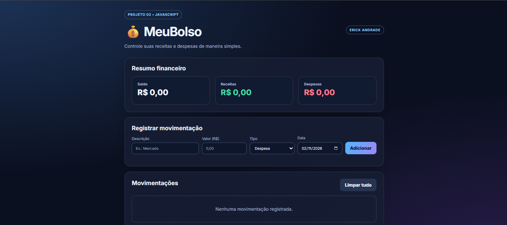

# 💰 MeuBolso — Controle Financeiro

### 🚀 Controle suas finanças de maneira simples, prática e organizada!

Aplicação web para registrar receitas, despesas e acompanhar o saldo financeiro pessoal.

 

### 🌐 ACESSE O APLICATIVO

  

**👉 [CLIQUE AQUI PARA ABRIR O MEUBOLSO](https://erickandrad07.github.io/controle-de-gastos/)**

 

---

## 📸 Visualização do Projeto

<em>Interface do MeuBolso — Controle Financeiro</em>

---

## 📌 Sobre o Projeto

O **MeuBolso** é uma aplicação web desenvolvida para facilitar o controle financeiro pessoal.

Com uma interface simples e intuitiva, o usuário pode registrar receitas e despesas, acompanhar suas movimentações e visualizar o saldo disponível.

Este projeto integra meu portfólio de estudos em **Análise e Desenvolvimento de Sistemas (ADS)**, permitindo aplicar conceitos fundamentais de programação e desenvolvimento web.

### 🎯 Objetivos do Projeto

- Desenvolver habilidades práticas em HTML, CSS e JavaScript.
- Trabalhar com lógica de programação.
- Praticar manipulação do DOM.
- Implementar cálculos e atualização dinâmica de valores.
- Utilizar armazenamento local de informações.
- Desenvolver interfaces responsivas.
- Aprimorar a organização do código.

---

## ⚙️ Funcionalidades

| Funcionalidade | Descrição |
|---|---
